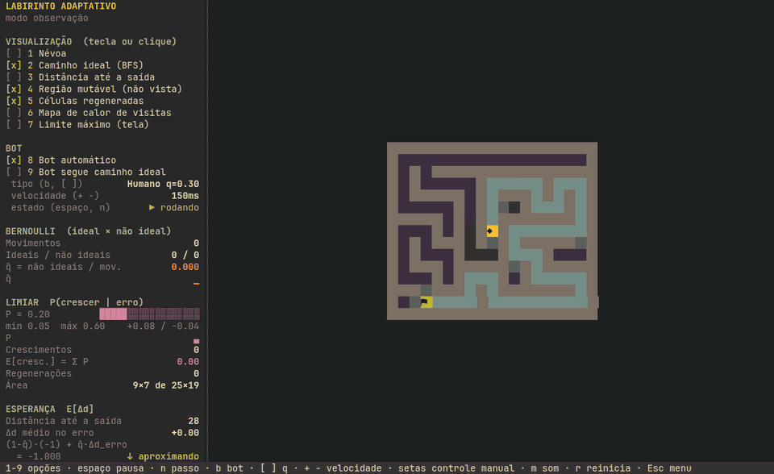
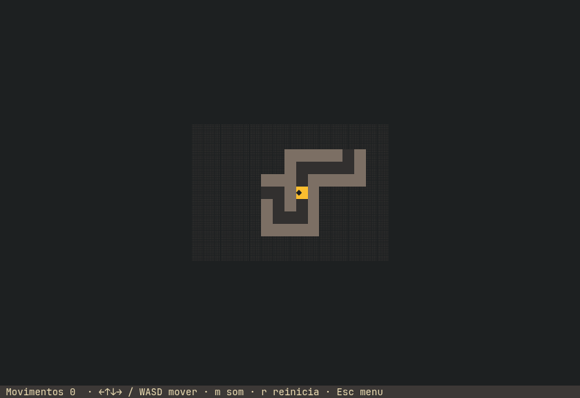
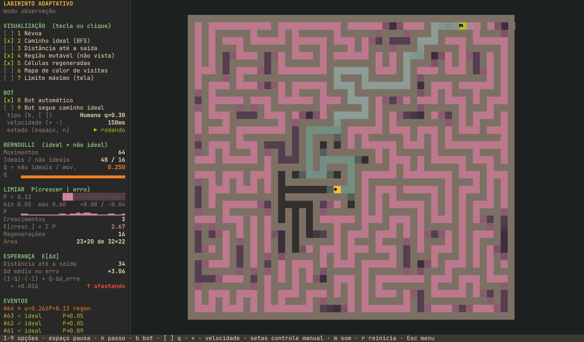
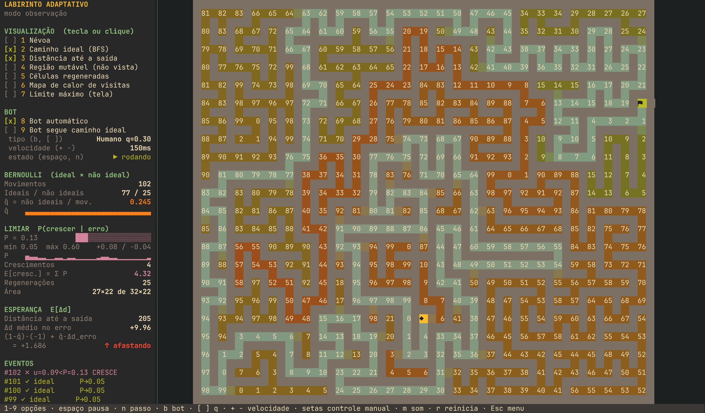

# Labirinto Adaptativo

Jogo de labirinto para terminal (Go + tcell) em que o jogador **nasce no centro** e a parte do
labirinto **que ainda não foi vista** muda conforme o comportamento do jogador.

Estudo Dirigido 02 — Probabilidade e Estatística (UTP, 2026/02).



<sub>Modo de observação, sem névoa: **rosa** = região regenerada após um erro · **escuro** = já visto (fixo) ·
**azul** = caminho ideal até a saída (bandeira). Vídeo em MP4: [docs/observacao.mp4](docs/observacao.mp4).</sub>

## Instalar

Requer Go 1.23+ e um terminal com cores (kitty, alacritty, gnome-terminal...). Som opcional via PulseAudio (`pacat`).

```sh
go install github.com/eduardo-moro/labirinto-adaptativo@latest
labirinto-adaptativo
```

ou, a partir do código:

```sh
git clone https://github.com/eduardo-moro/labirinto-adaptativo
cd labirinto-adaptativo
go build -o labirinto .
./labirinto                 # menu: Jogar / Observar algoritmo
./labirinto -csv partidas.csv   # salva cada partida concluída em CSV
./labirinto -contraste          # já abre com o labirinto em alto contraste
```

O tamanho máximo do labirinto é o tamanho da janela. **Redimensionar a janela reinicia o jogo.**

### Jogar
`←↑↓→` / `WASD` / `hjkl` movem · `m` som · `c` alto contraste · `r` reinicia · `Esc` menu

**Alto contraste (`c`, nos dois modos):** fundo preto, paredes brancas e cores saturadas no
labirinto, para projetor. Painel, menus e barra de status não mudam.



O jogador (◆) nasce no centro e só enxerga três passos pelos corredores; o resto fica sob a névoa
e é refeito a cada erro.

### Sons
O jogo sintetiza os tons e toca pelo PulseAudio (`pacat`); `m` liga/desliga.

| Evento | Som |
|---|---|
| movimento ideal | "sonar" curto — **mais agudo quanto mais perto da saída** (330 → 990 Hz) |
| movimento não ideal | blip grave (196 Hz) |
| labirinto cresceu | duas notas descendo (Sol → Dó) |
| saída | arpejo de Dó maior subindo |

No modo manual todo movimento soa (sons seguidos se sobrepõem num mixer). Com o bot
automático, os sons de passo só tocam quando nada está soando, para não virar ruído.

Sem `pacat`, cai para o bell do terminal (1 bipe = cresceu, 3 = saída).

### Observar algoritmo
O painel lateral mostra tudo em tempo real. O bot começa **desligado** (ligue com `8`, ou jogue com as setas).

| Tecla | Função |
|---|---|
| `1` | Névoa (liga/desliga a visão do jogador) |
| `2` | Caminho ideal (BFS) |
| `3` | Distância de cada célula até a saída (número + cor) |
| `4` | Região mutável (células não vistas, que podem ser regeneradas) |
| `5` | Células regeneradas no último erro (rosa, some em 5 passos) |
| `6` | Mapa de calor de visitas |
| `7` | Limite máximo (área da tela) |
| `8` | Bot automático |
| `9` | Bot segue o caminho ideal (ignora o tipo de bot) |
| `espaço` / `n` | pausa / um passo |
| `b` · `[` `]` | troca o bot (Perfeito, Humano, Aleatório) · ajusta o q do bot humano |
| `+` `-` | velocidade |
| setas | assume o controle manual (desliga o bot) |

Também é possível clicar nas opções do painel com o mouse.

| Região mutável e regeneração (`4` `5`) | Distâncias BFS até a saída (`3`) |
|---|---|
|  |  |

### Simulação sem interface

```sh
./labirinto -sim 500 -bot humano -q 0.3 -csv humano.csv
./labirinto -sim 200 -bot perfeito
./labirinto -sim 20  -bot aleatorio -max 20000
```

Imprime média, desvio padrão e IC 95% de: movimentos, q̂, crescimentos (observados × esperados),
área final, Δd médio no erro e taxa de vitória.

## Regra probabilística

Cada movimento é um **ensaio de Bernoulli**: *ideal* (a distância BFS até a saída cai 1) ou
*não ideal*.

- **Ideal** → o labirinto **não muda**; o limiar cai `β` (mínimo `L_MIN`).
- **Não ideal** → o limiar sobe `α` (máximo `L_MAX`); sorteia `u ~ U(0,1)`:
  - `u < limiar` → a área ativa **cresce** `G` células por lado (até o tamanho da tela) e a saída é
    sorteada na nova borda;
  - em qualquer caso, toda a parte **não vista** é **regenerada** aleatoriamente.

Valores padrão (`game.go`): `L0=0.20, L_MIN=0.05, L_MAX=0.60, α=0.08, β=0.04, G=2`.

Estatísticas exibidas:

- `q̂ = não ideais / movimentos` (frequência relativa)
- `E[crescimentos] = Σ P(crescer)` sobre os erros (soma de esperanças de Bernoulli)
- `E[Δd] = (1−q̂)·(−1) + q̂·Δd_erro` → negativo = o jogador se aproxima da saída em média

### Resultados (labirinto máximo 34 × 21)

| Bot | Partidas | Movimentos (média) | q̂ | E[Δd] | Saíram |
|---|---|---|---|---|---|
| Perfeito | 200 | 32,9 | 0 | −1,000 | 100% |
| Humano (q = 0,30) | 1000 | 3643 | 0,286 | −0,134 | 100% |
| Aleatório | 20 | ~18 900 | 0,498 | +0,003 | 20% (em 20 mil mov.) |

Crescimentos observados × esperados (Σ P), bot humano: **5,61 × 5,55**, diferença 0,05 ± 0,12 (IC 95%).

## Geração

O labirinto é sempre **perfeito** (uma árvore geradora): um único caminho entre duas células
quaisquer. Na regeneração, as passagens das células já vistas são preservadas; o resto é refeito
com DFS aleatório (corredores longos) e os pedaços são unidos com Kruskal aleatório (union-find).
`go test` verifica essas invariantes em milhares de movimentos.
